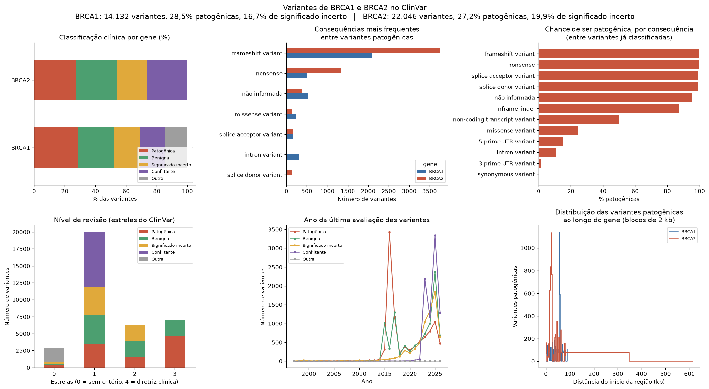

# 🧬 Banco de Variantes Genéticas de BRCA1 e BRCA2

[](https://colab.research.google.com/github/alinesmdados/banco-variantes-brca/blob/main/banco_variantes_brca.ipynb)


[](https://github.com/alinesmdados/banco-variantes-brca/actions/workflows/atualizar_banco.yml)

Pipeline de dados que monta um **banco relacional (SQLite)** com as variantes genéticas dos genes **BRCA1** e **BRCA2** registradas no **ClinVar** (NCBI), responde perguntas clínicas com **SQL** e apresenta os resultados em um **dashboard**.

Variantes patogênicas em BRCA1/BRCA2 estão associadas à síndrome de câncer de mama e ovário hereditários. Organizar essas variantes por classificação clínica, tipo de alteração e nível de evidência ajuda a entender um dos principais desafios da genética clínica: as **variantes de significado incerto**.

## Dashboard



*Painel gerado automaticamente a partir do banco. A imagem é atualizada todo mês.*

## Principais resultados

Na primeira execução (novembro de 2026), o banco reuniu **36.178 variantes**:

| Gene | Variantes | Patogênicas | Significado incerto |
|---|---:|---:|---:|
| BRCA1 | 14.132 | 28,5% | 16,7% |
| BRCA2 | 22.046 | 27,2% | 19,9% |

- Variantes que **truncam a proteína** (*frameshift*, *nonsense* e de sítio de *splicing*) são classificadas como patogênicas em quase 100% dos casos já interpretados, enquanto as *missense* ficam em torno de 25%. Isso é coerente com o papel dos genes BRCA na reparação do DNA: perder a proteína inteira tende a ser mais grave que trocar um único aminoácido.
- Cerca de **1 em cada 5 variantes** ainda tem **significado incerto**, o que mostra o tamanho do desafio na interpretação de exames genéticos.

Os números mudam a cada atualização do ClinVar. Os valores atuais ficam em [`dados/visao_geral.csv`](dados/visao_geral.csv).

## Arquitetura

```
NCBI ClinVar (API E-utilities)
        │  esearch + esummary (JSON)
        ▼
etl_clinvar.py ── transformação ──► clinvar_brca.db (SQLite, schema.sql)
                                            │
                                            ▼
                          consultas.sql ──► dashboard.py ──► painel (6 gráficos)
```

### Atualização automática (GitHub Actions)

O workflow [`.github/workflows/atualizar_banco.yml`](.github/workflows/atualizar_banco.yml) roda **todo dia 1º do mês** (e sempre que o código do pipeline muda). Ele executa os testes, baixa os dados do ClinVar, reconstrói o banco, gera o painel e salva tudo na pasta `dados/`. Assim, o banco permanece atualizado sem intervenção manual.

## Modelo de dados

| Tabela | Conteúdo |
|---|---|
| `genes` | BRCA1 e BRCA2 (ID do NCBI Gene, cromossomo) |
| `classificacoes` | Classificação original do ClinVar e categoria de análise (Patogênica, Benigna, Significado incerto, Conflitante, Outra) |
| `variantes` | Uma linha por variante: tipo, consequência molecular, alteração na proteína, posição (GRCh38), estrelas de revisão, data da última avaliação |
| `condicoes` / `variante_condicao` | Doenças associadas às variantes (relação N:N) |
| `vw_variantes` | *View* analítica que reúne as tabelas |

## Perguntas respondidas com SQL

1. Quantas variantes existem por gene e qual a proporção de patogênicas e de significado incerto?
2. Como as categorias clínicas se distribuem em cada gene?
3. Quais consequências moleculares são mais comuns entre as variantes patogênicas? *(função de janela `RANK() OVER`)*
4. Qual a chance de uma variante ser patogênica de acordo com o tipo de consequência?
5. Qual o nível de evidência (estrelas) das classificações?
6. Como as avaliações se distribuem ao longo dos anos?
7. Em quais regiões dos genes se concentram as variantes patogênicas?
8. Quais condições são mais associadas às variantes patogênicas?

## Como usar

### No Google Colab (recomendado)
Clique em **"Abrir no Colab"** e execute *Ambiente de execução → Executar tudo*. O notebook usa o banco pronto da pasta `dados/` e roda em poucos segundos. Para baixar tudo de novo do ClinVar (10 a 15 minutos), altere `ATUALIZAR_DO_CLINVAR = True`.

### Localmente
```bash
git clone https://github.com/alinesmdados/banco-variantes-brca.git
cd banco-variantes-brca
pip install -r requirements.txt
sqlite3 dados/clinvar_brca.db < consultas.sql    # consulta o banco pronto
python etl_clinvar.py --db clinvar_brca.db       # ou reconstrói o banco do zero
```

O arquivo `dados/clinvar_brca.db` pode ser aberto em ferramentas como DBeaver, Power BI ou Metabase.

## Testes

```bash
pytest                              # 17 testes do ETL, do banco e das consultas
python -m doctest etl_clinvar.py    # exemplos da documentação
```

## Proteção de dados (LGPD)

A LGPD (Lei nº 13.709/2018) classifica o **dado genético** como **dado pessoal sensível** (art. 5º, II). Este projeto usa apenas dados **públicos e agregados** do ClinVar, que descrevem variantes e não indivíduos. O notebook discute os cuidados necessários caso o banco fosse cruzado com dados de pacientes.

## Estrutura

```
banco-variantes-brca/
├── schema.sql                  # modelo do banco
├── etl_clinvar.py              # extração, transformação e carga
├── consultas.sql               # consultas analíticas
├── dashboard.py                # gráficos do painel
├── banco_variantes_brca.ipynb  # notebook com todo o fluxo
├── test_banco.py               # testes automatizados
├── dados/                      # banco pronto, painel e resumo (gerados automaticamente)
├── .github/workflows/          # atualização mensal via GitHub Actions
├── requirements.txt
└── LICENSE
```

## Fonte dos dados

Landrum MJ et al. *ClinVar: improving access to variant interpretations and supporting evidence.* Nucleic Acids Research, 2018. https://www.ncbi.nlm.nih.gov/clinvar/

## Autora

**Aline Machado**: analista de dados, pós-graduada em Ciência de Dados, com formação em Direito e atuação em proteção de dados (LGPD).

## Licença

Distribuído sob a licença MIT. Veja o arquivo [LICENSE](LICENSE).
